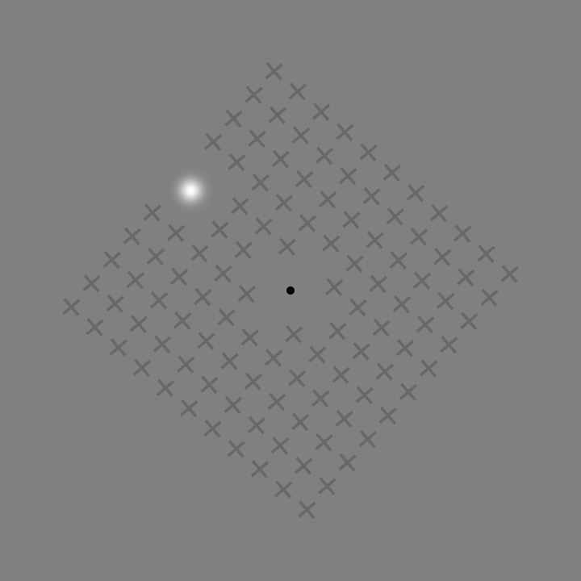
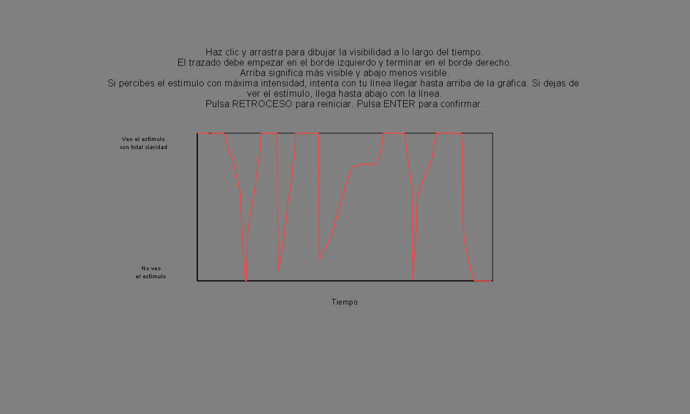

# Motion-induced blindness with three report methods: experimental task

This folder contains the experimental task of the study: a motion-induced blindness (MIB) display in which participants report the visibility of a target with three methods, a button, a slider and temporal experience tracing (TET). It is written in [PsychoPy](https://www.psychopy.org/).

<table>
  <tr>
    <td align="center" width="50%"><br>
      <sub>The MIB display (peripheral trial)</sub></td>
    <td align="center" width="50%"><br>
      <sub>Drawing the trace in the TET (Spanish)</sub></td>
  </tr>
</table>

> **This is not the program that collected the data.** The 18 sessions of the study were run with the original program, kept in [`../original_task`](../original_task), under PsychoPy 2022.2.5. This program is a reorganization of that code that shows participants the same task: same stimuli, timing, design, texts and order of the screens. See [Differences from the original program](#differences-from-the-original-program).

## Quick start

1. **Download** the repository (*Code → Download ZIP*, then unzip it) or clone it with git, and open the folder `Materials/psychopy_task`.
2. **Set up the lab.** Open `task/init.py` and fill in the screen width (cm), viewing distance (cm) and resolution under `MONITOR_*`, and the port of the slider under `SERIAL_PORT`. Without the device, set `SLIDER_INPUT = "keyboard"` to use the up and down arrows.
3. **Run a participant.** Double-click `run_task.bat`.
   - A form asks for the participant number, age and gender. The number sets the order of the blocks, so it has to be numeric.
   - The task then starts in full screen, and the instructions guide the participant from there. Between blocks, the participant calls the experimenter.
   - Press `Esc` to quit at any time; the trials completed up to that point are kept.
4. **Collect the data.** Each session is saved in `data/mib_<participant>_<date>.csv`.

If the slider does not respond at the start of the session, the task stops with a message before opening the window.

### What `run_task.bat` does

The launcher makes the task run with the same software on every computer (Windows):

- If **PsychoPy 2026.1.1** (Standalone) is installed, it uses it.
- Otherwise, it installs [uv](https://docs.astral.sh/uv/) (no administrator rights needed) and runs the task in an isolated Python 3.10 environment with the package versions in `requirements.txt`.
  - The first time, this needs internet and takes a few minutes; later runs start at once.
  - Nothing else on the computer changes.

`run_task.bat test` runs a short automatic session (no participant or slider needed) to check the installation, and saves screenshots in `data/screenshots`.

On macOS or Linux, install PsychoPy 2026.1.1, or run `uv run --no-project --python 3.10 --with-requirements requirements.txt main.py` in the task folder. You can also open `main.py` in PsychoPy Coder and press *Run*. The launcher has only been tested on Windows.

## Procedure

`Experiment.run()` in `task/experiment.py` gives the order of the session:

1. General instructions, a static example of the display, and a 15-s demonstration without responses.
2. One block per method, in one of the six possible orders (the permutation of button, slider and TET at position *participant number modulo 6*):

| Block | Before the experimental trials | Response during the 30-s trial |
|---|---|---|
| Button | 5 practice trials | Hold the space bar while the target is not seen |
| Slider | A free try of the slider, 6 calibration trials (2 of each type) and 5 practice trials | Move the slider to follow the visibility of the target |
| TET | A free try of the drawing screen and 5 practice trials | None: after the trial, draw the visibility over time with the mouse |

Each block has 12 experimental trials in random order: 8 `peripheral` (target at 5.45 cm from fixation) and 4 `near_fixation` (at 1 cm, in the same direction). Practice trials are peripheral.

In the calibration trials there is no mask or fixation point: a target at the centre of the screen changes in contrast, and the participant follows it with the slider, seeing the response bar. The contrast goes up (`calibration_up`) or down (`calibration_down`) in 3 s and stays for 2 s, or it follows a 0.2-Hz sinusoid for 30 s (`calibration_sinusoidal`).

## Settings

Everything that can be adjusted is in `task/init.py`:

| Setting | What it does |
|---|---|
| `MONITOR_*` | screen width and viewing distance (cm), resolution. Stimuli are defined in cm |
| `SLIDER_INPUT`, `SERIAL_*` | slider: device or keyboard, and the serial port of the device |
| `TRIAL_S`, `DEMO_S`, `CALIBRATION_*` | timing (s) |
| `N_PER_TYPE`, `N_PRACTICE`, `CALIBRATION_TRIALS` | design |
| `SAMPLE_HZ`, `DEVICE_HZ` | samples per second in the data file, and queries per second to the slider |

The stimuli are defined at the top of `task/helper.py`. All texts shown to participants (in Spanish) are in `task/text.py`.

### The slider

The slider is a potentiometer connected to the computer through a serial port. The program sends the character `R`, and the device answers with its level (0 to 4095) as a line of text (`SERIAL_*` in `task/init.py`). The response is the level as a proportion of that range, so it goes from 0 (bottom) to 1 (top).

## Data

One CSV per session, in long format: one row per sample of the response, at 50 Hz. Every trial is written as soon as it ends.

| Column | Content |
|---|---|
| `participant_id`, `age`, `gender` | participant; `gender` is one of the options of the form, in Spanish (`Mujer`, `Hombre`, `No binario`, `Prefiero no decir`, `Otro`) |
| `frame_rate` | refresh rate measured at the start of the session (Hz); empty if no stable value was obtained |
| `phase` | `calibration`, `practice` or `experimental` |
| `block` | position of the block of this method in the session (1 to 3) |
| `method` | `button`, `slider` or `tet` |
| `trial_in_block` | trial within that phase of the block |
| `trial_type` | `peripheral`, `near_fixation`, `calibration_up`, `calibration_down` or `calibration_sinusoidal` |
| `time_s` | time of the sample from the start of the trial (s) |
| `target_contrast` | contrast of the target at that time (0 to 1) |
| `response` | the response as recorded (see below) |

`response` is what the participant did, before any processing:

- `button`: `1` while the space bar is held down (the target is **not** seen), `0` otherwise.
- `slider`: position of the slider, from 0 to 1.
- `tet`: height of the trace at that time, from 0 (bottom of the axes) to 1 (top). The participant draws the trace after the trial, and it is interpolated to the time grid of the other methods.

Button and slider responses are read on every frame, so a sample has the value of the first frame at or after its time. The last sample of a trial can be missing if the last frame came before it, so a 30-s trial can have slightly fewer than 1500 rows.

## Folder structure

```
run_task.bat       launcher (Windows): finds or sets up PsychoPy and runs the task
main.py            entry point: start form and session
requirements.txt   package versions (Python 3.10)
task/init.py       settings
task/helper.py     stimuli, order of the blocks, trial lists, window, slider
task/text.py       texts shown to participants
task/experiment.py the session: instructions, calibration, practice, blocks, TET, data
docs/              images for this README
data/              output (not tracked)
```

## Differences from the original program

We ran the two programs with the same simulated inputs (keyboard, mouse, slider and order of the trials) and the complete design, with shorter trials, and compared them:

- **What participants see.** The sequence of screens and trials is the same, and so are the texts and their position, size and colour. At the resolution of the lab, the trial displays are identical pixel by pixel, except for two pixels that differ by 1/255. PsychoPy 2022.2.5 draws some letters of small text worse than 2026.1.1 (on our test computer, for example, it lost the *l* and *i* of the labels of the TET axes), so a few text screens differ slightly.
- **The data.** The same trials are saved, with the same order of blocks and of trials for the same random seed, time grid and target contrast. For the same drawing, the TET response is identical.

Timing and the slider itself were not part of this comparison: it was run without the device, and on a computer other than the one in the lab.

What changes is not visible to participants:

- The code is organized in the modules listed above, and the settings are in one file. The options that the study did not use are gone (trials without a target, static mask, leaving out the slider block, forcing an order of the blocks).
- One data file per session, instead of five per participant. It keeps only the variables above, and a new session never overwrites or adds to a previous one. The 18 sessions in [`Input/sessions`](../../Input/sessions) were reformatted to this format without changing the responses.
- The form before the task asks to choose the gender, with no default option, and it asks again if something is missing, without an error message.
- If the slider does not respond at the start of the session, the task stops. The original program went on with the keyboard as a backup, while the instructions still mentioned the slider.
- If the connection with the slider fails during the session, the task stops with an error (the trials completed are kept). The original program switched to the keyboard without warning.
- Practice trials of the slider read its position just before the trial starts, as the other slider trials do, rather than on the first frame.
- `run_task.bat test` is a short automatic session, which replaces the short manual session of the original program (`--mode test`).
