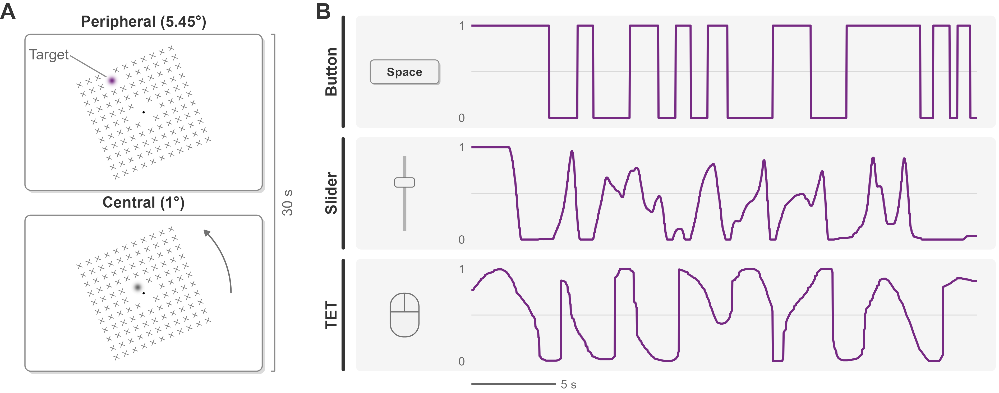
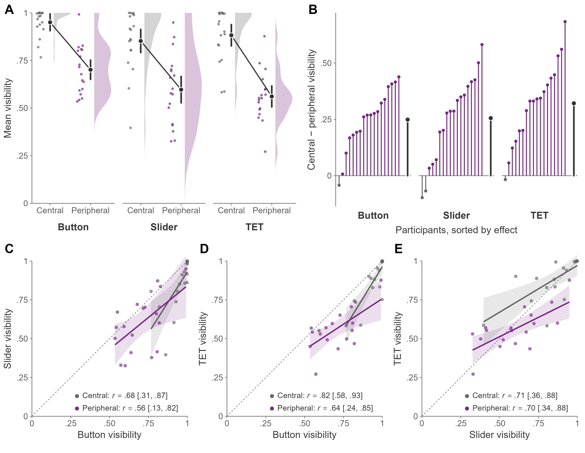
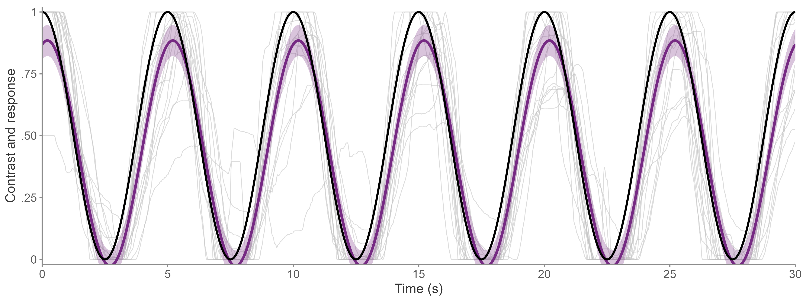
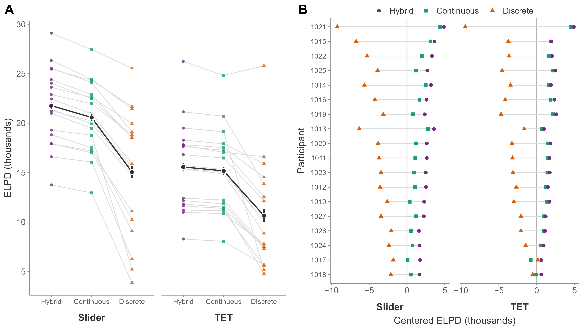
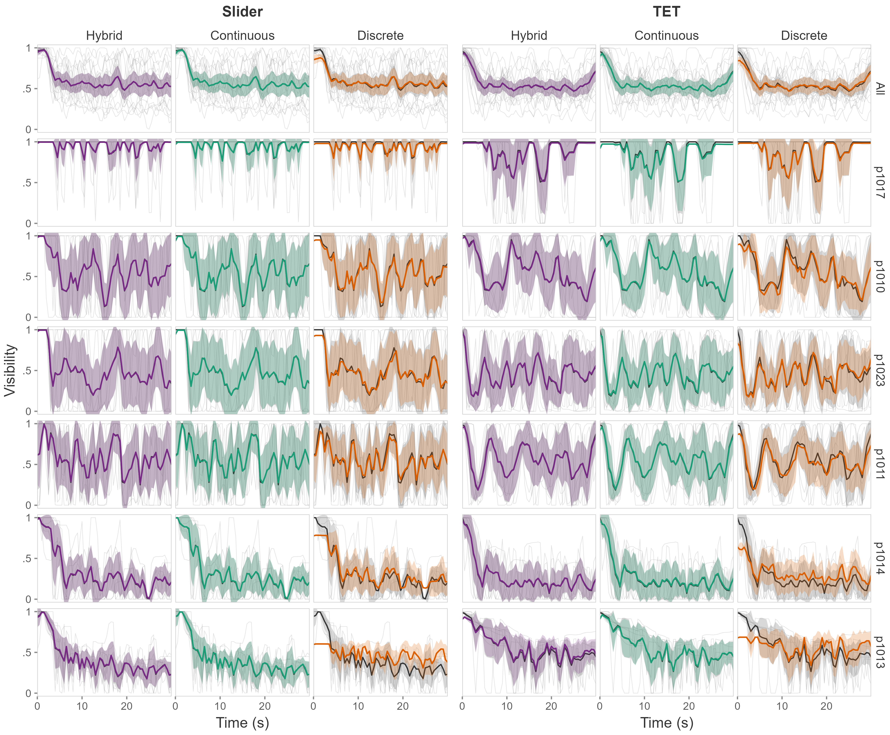
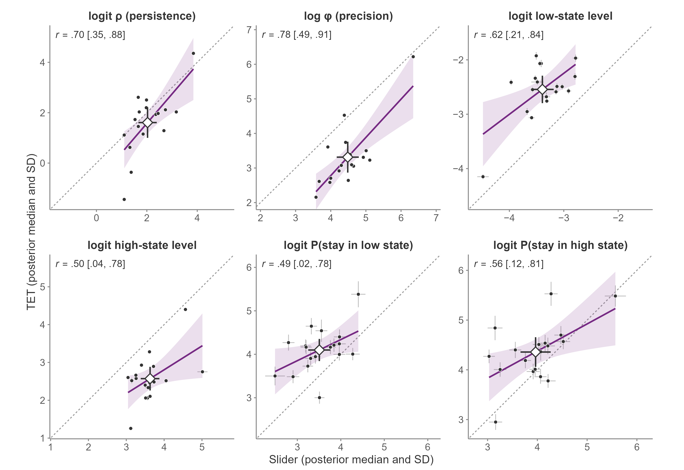

```{r}
#| label: setup-analysis-objects
#| include: false

knitr::opts_chunk$set(
  echo = FALSE,
  warning = FALSE,
  message = FALSE
)

source("scripts/functions.R")

an <- load_analysis_objects("analysis")
mc <- load_analysis_objects("model_comparison_mm") # PSIS-LOO with moment matching
mc_psis <- load_analysis_objects("model_comparison") # PSIS-LOO without moment matching
pc <- load_analysis_objects("parameter_convergence")
st <- load_analysis_objects("states")

# Sample
s <- an$sample_description

# Sensitivity of the design
sens_dz <- an$sensitivity$dz
sens_r <- an$sensitivity$r

# Means
m_trial <- function(trial) mean(an$fig_cells$mean_visibility[an$fig_cells$trial_type == trial])

# Post hoc contrasts between methods
ph <- as.data.frame(an$h2_method)
ph_txt <- function(contrast) {
  d <- ph[ph$contrast == contrast, ]
  sprintf("$M_\\text{diff}$ = %s, %s", nz(d$estimate, 3), t_txt(d$t.ratio, d$df, d$p.value, p_holm))
}

# MIB with each method
mib <- function(this_method) {
  d <- an$mib_by_method[an$mib_by_method$method == this_method, ]
  t_txt(d$t, d$df, d$p)
}

# Convergence
term_txt <- function(contrast, term) {
  d <- an$h3_terms[an$h3_terms$contrast == contrast & an$h3_terms$term == term, ]
  label <- if (term == "x") "\\text{Method}" else "\\text{Method} \\times \\text{Location}"
  sprintf("$\\beta_{%s}$ = %s, %s", label, fmt(d$estimate, 3), t_txt(d$statistic, an$h3_fit$df.residual[an$h3_fit$contrast == contrast], d$p_holm, p_holm))
}
r_range <- range(an$h3_correlations$r)

# Tracking of the sinusoidal calibration trials
track <- function(what) an$calibration_estimates[an$calibration_estimates$measure == what, ]
track_ci <- function(what, show = nz, unit = "") {
  d <- track(what)
  sprintf("%s%s, 95%% CI [%s, %s]", show(d$estimate), unit, show(d$ci_low), show(d$ci_high))
}
track_range <- function(what) range(an$calibration_tracking[[what]])
stab <- function(what) an$calibration_stability$r[an$calibration_stability$measure == what]
stopifnot(
  track("lag")$ci_low > 0,
  track("mean_level")$ci_high < .5,
  track_range("lag")[1] < 0,
  all(an$calibration_vs_mib$ci_low < 0), all(an$calibration_vs_mib$ci_high > 0)
)

# Step 1: fit of the models
elpd <- mc$elpd_pointwise
n_cells <- nrow(mc$vs_hybrid) / 2
n_best <- function(m, this_model = "hybrid") sum(m$elpd_pointwise$wins$n_best[m$elpd_pointwise$wins$model == this_model])
vs <- function(this_method, this_model) mc$vs_hybrid_summary[mc$vs_hybrid_summary$method == this_method & mc$vs_hybrid_summary$model == this_model, ]
n_div <- function(m) sum(m$fig_elpd$divergences > 0)
rhat_max <- mc$rhat_max

# Pareto k before and after moment matching
n_points <- sum(mc_psis$fig_elpd$n_obs)
n_high_points <- function(m) sum(round(m$fig_elpd$prop_k_gt_0.7 * m$fig_elpd$n_obs))
n_words <- function(n) if (n < 10) c("one", "two", "three", "four", "five", "six", "seven", "eight", "nine")[n] else big0(n)

# Step 2: parameters of the hybrid model in each method
par_values <- function(v, this_method) pc$params_hybrid$median[pc$params_hybrid$variable == v & pc$params_hybrid$method == this_method]
cmp <- function(v) pc$params_compare[pc$params_compare$variable == v, ]
cmp_txt <- function(v) t_txt(cmp(v)$t, cmp(v)$df, cmp(v)$p_holm, p_holm)

# Times implied by the parameters of the hybrid model
par_times <- pc$par_times
times <- function(this_method, what) fmt(par_times[[what]][par_times$method == this_method], 1)

# Times implied by the parameters, with the bootstrap 95% CI of the median across participants
time_ci <- function(this_method, what, digits = 1) {
  d <- st$times_summary[st$times_summary$method == this_method & st$times_summary$measure == what, ]
  sprintf("%s s (95%% CI [%s, %s])", fmt(d$median, digits), fmt(d$ci_low, digits), fmt(d$ci_high, digits))
}

# Step 3: correlations between methods
me <- function(v) pc$params_me[pc$params_me$variable == v, ]
# Probability of direction of the disattenuated correlations, in the table of the parameters and
# in the text
pd_value <- function(v) if (me(v)$pd > .999) "> .999" else nz(me(v)$pd, 3)
pd_txt <- function(v) if (me(v)$pd > .999) "*pd* > .999" else sprintf("*pd* = %s", nz(me(v)$pd, 3))

# Statements written in words in the Results
stopifnot(
  n_div(mc) == 0,
  rhat_max < 1.01,
  all(an$h3_correlations$p_holm < .05),
  n_best(mc) == n_cells,
  vs("slider", "discrete")$n_reliably_worse == n_cells / 2,
  vs("tet", "discrete")$n_reliably_worse == n_cells / 2,
  all(as.data.frame(elpd$posthoc)$p.value < .001),
  all(as.data.frame(elpd$posthoc)$estimate > 0),
  # Pareto k footnote: the responses still above .7 come from one participant with TET, and leaving
  # this participant out does not change the comparison between models
  nrow(distinct(mc$high_k_ids, participant_id)) == 1, all(mc$high_k_ids$method == "tet"),
  n_best(list(elpd_pointwise = mc$elpd_without_high_k)) == 2 * mc$elpd_without_high_k$n,
  all(as.data.frame(mc$elpd_without_high_k$posthoc)$p.value < .001),
  all(as.data.frame(mc$elpd_without_high_k$posthoc)$estimate > 0),
  all(mc$elpd_without_high_k$anova$`Pr(>F)` < .05),
  all(mc$vs_hybrid_without_high_k$n_reliably_worse[mc$vs_hybrid_without_high_k$model == "discrete"] ==
    mc$elpd_without_high_k$n),
  cmp("rho")$p_holm > .05,
  all(pc$params_compare$p_holm[pc$params_compare$variable != "rho"] < .05),
  cmp("phi")$diff < 0, cmp("attractor_mean[1]")$diff > 0, cmp("attractor_mean[2]")$diff < 0,
  cmp("theta[1,1]")$diff > 0, cmp("theta[2,2]")$diff > 0,
  all(pc$params_me$rho_me > 0),
  min(pc$params_me$pd[pc$params_me$variable %in% c("phi", "rho", "attractor_mean[1]")]) >
    max(pc$params_me$pd[pc$params_me$variable %in% c("attractor_mean[2]", "theta[2,2]", "theta[1,1]")]),
  me("attractor_mean[2]")$pd_label == "likely existing", me("theta[2,2]")$pd_label == "likely existing",
  me("theta[1,1]")$pd_label == "possibly existing",
  all(round(par_times$half, 1) == .2),
  # Numbers written in the abstract (YAML header), which cannot be computed inline
  fmt(track("lag")$estimate, 1) == "0.2",
  # Participants and Discussion
  sum(an$calibration_metrics$exclusion_candidate) == 0,
  min(c(par_times$stay_low, par_times$stay_high)) >= 1, max(c(par_times$stay_low, par_times$stay_high)) < 3.5,
  abs(mean(an$h3_correlations$r[an$h3_correlations$contrast != "slider vs tet"]) - mean(an$h3_correlations$r[an$h3_correlations$contrast == "slider vs tet"])) < .1
)
```

Whether perceptual awareness is graded or all-or-none remains an open question in consciousness science [@simione2025; @windey2015]. According to a graded view, a stimulus can be experienced with different degrees of clarity, so that awareness varies along a continuum [@overgaard2021]. According to an all-or-none view, a stimulus either reaches awareness or it does not. This transition has been linked to a sudden, widespread surge of brain activity, called "ignition" [@delcul2007; @sergent2004], although an all-or-none brain response need not imply an all-or-none experience [@cohen2023]. Both views have empirical support. Participants often use the intermediate points of subjective visibility scales, and these ratings track performance [@jimenez2019; @tagliabue2016] and neural responses [@eiserbeck2022; @tagliabue2016]. In other studies, however, participants used a continuous scale as if it were binary [@sergent2004], and manipulations that made a stimulus harder to perceive, such as the attentional blink or magnetic stimulation of the visual cortex, reduced how often it is seen, but not how precisely it is seen when it is [@asplund2014; @koivisto2017]. However, inferences regarding the nature of visual experience can depend on factors such as the specific task employed, the focus of attention, the response format, and even how the data are modeled [@cohen2023; @karabay2022; @koivisto2021; @nieuwenhuis2011; @sy2021]. Several accounts have attempted to reconcile both views, proposing, for example, that different levels of representation are accessed independently [@kouider2010], that low-level features are experienced in a graded manner and high-level features in an all-or-none manner [@windey2013], or that the dichotomy should be replaced by several dimensions along which awareness can vary [@fazekas2018; @windey2015].

Most of this evidence regarding the nature of conscious experience comes from studies assessing visibility of briefly presented stimuli, each followed by a single report [e.g., @asplund2014; @jimenez2019; @sergent2004]. Even when a stimulus lasts longer, a single report compresses the whole trial into one value and cannot tell how visibility of the same stimulus changes across time. For instance, an intermediate visibility rating could reflect a stimulus that was seen with an intermediate degree of clarity throughout the trial, a stimulus that was fully visible for only part of the time [@fazekas2018], or an uncertain decision about a stimulus that was either seen or not [see @overgaard2021, for a discussion]. Conversely, ratings clustered at both ends of the scale, which have been taken as evidence for the all-or-none view [@delcul2007; @sergent2004; see also @windey2015], say nothing about whether the stimulus vanished abruptly or faded within a trial. Averages can also hide abrupt changes [@sergent2021], as brain signals recorded with magnetoencephalography have been shown to rise gradually on average but change abruptly within single trials [@sekar2012]. Distinguishing these possibilities requires a graded report of how visibility changes over time, ideally while the stimulus stays constant, so that changes in the report cannot come from the stimulus.

Motion-induced blindness [MIB\; @bonneh2001] offers these conditions. In MIB, a salient stationary target disappears from awareness for seconds at a time when a pattern (the mask) moves around it, although the target remains on the screen. Disappearances are more frequent when the target is farther from fixation and also depend on its size and on the speed of the mask [@bonneh2001; @hsu2004; @soni2025]. Although the specific mechanisms of MIB are still debated [@bonneh2014; @hsu2004; @new2008; @scholvinck2009], it is often described as an all-or-none experience [@bonneh2014; @katkov2024]. Yet in most studies, participants simply press and hold a key while the target is invisible [for a review, see @soni2025], a report that cannot distinguish graded changes in visibility.

One way to overcome this limitation is to ask participants to report their experience concurrently using a continuous scale. For instance, in binocular rivalry, in which each eye sees a different image and perception alternates between them, observers who reported which image they perceived with a joystick instead of buttons showed gradual transitions between the two images, which led @naber2011 to argue that all-or-none rivalry transitions are likely an artifact of binary responses [see also @skerswetat2023]. Rivalry, however, concerns which of two images is seen, not whether a stimulus is seen at all. Moreover, continuous reports are not necessarily a direct readout of experience. In rivalry, joystick reports lag by more than 0.8 s behind a reflexive eye movement that follows the image currently seen [@naber2011], and tracking responses reflect motor variability and effort that can be misattributed to perception [@bonnen2015; @straub2022]. In addition, different factors such as the attentional demands of the task can change the dynamics of disappearance in MIB [@scholvinck2009], so responding while viewing the display may change the very disappearances it is meant to measure.

Another approach is to ask participants to reconstruct their experience afterward. In Temporal Experience Tracing [TET\; @jachs2022], participants draw, once the experience has ended, how one or more of its dimensions changed over time. TET was introduced to study meditation sessions of 15 to 20 minutes [@jachs2022] and has since been used in a wide range of contexts, such as breathwork, pain, cognitive and physical exertion, and brain stimulation [@holgado2025; @holgado2026; @lewishealey2024; @niedernhuber2024; @perezdiaz2026]. Because the trace is drawn retrospectively, participants do not respond while viewing the stimulus, but the trace depends on memory, which may distort the time course of the experience [@alaybek2022; @ariely1998; @khoshnejad2014]. To our knowledge, TET has not been used to track changes in the visibility of a visual stimulus or intervals as short as 30 s, nor has it been compared with a concurrent report. A slider and TET thus have complementary strengths and weaknesses. The slider adds a concurrent motor and attentional demand but does not require remembering the trial, whereas TET avoids that demand at the cost of depending on memory. Agreement between them would therefore be more informative than either method alone, although both still rely on introspection and on how individuals use each scale [@campbell1959; @skora2021].

Continuous reports also allow us to explore the temporal dynamics of subjective visibility by comparing models of how reports change from one moment to the next. If visibility is graded, reports would change gradually and take any value. If it is all-or-none, they would switch between two visibility states. A third possibility, consistent with accounts in which graded and all-or-none aspects of awareness coexist [@kouider2010; @windey2013; @windey2014; @windey2015], is that reports switch between two states but move gradually toward each. Models of this kind, such as state-space and hidden Markov models, have already been used to study consciousness and subjective experience [@bastian2013; @goicoechea2025; @skerswetat2022; @wong2014; @zanesco2020], and applied to continuous reports of visibility, these models make it possible to ask whether visibility changes gradually, switches between two states, or does both.

## The Present Study

Here, we measured how the visibility of a target changes within a trial in MIB using two continuous reports: a slider measuring concurrent changes in target visibility, and TET, drawn after each trial. The same participants also reported visibility with a classic button press, which allowed us to test whether the continuous reports capture what is usually measured with a key. We preregistered our hypotheses and main analyses. We presented the target either in the periphery (5.45° from fixation) or close to fixation (1°), where MIB is expected to be weaker [@bonneh2001; @soni2025].

We first expected to replicate the MIB effect with the classic button response, and that varying the eccentricity of the target would modulate the rate of disappearances, with lower visibility for peripheral than for central targets (H1). We also expected the slider and TET to show the same effect (H2). Finding this effect only with the button would suggest that continuous methods miss visibility changes that participants report with a key. We also expected mean visibility to be positively associated across methods (H3), indicating that the three methods converge in capturing individual differences in overall subjective visibility.

Beyond these hypotheses, we also asked how continuous report methods can track objective and subjective visibility dynamics. In particular, we used the slider calibration trials, in which the target contrast fluctuated at a known rate, to examine how closely participants can track changes in intensity. Most importantly, we also modeled how subjective visibility changes from one moment to the next. To that aim, we compared three models of the reports. In the continuous model, reports gradually move toward a single state. In the discrete model, they switch between two states. In the hybrid model, they move gradually toward one of two states. Finally, we compared the parameters of the best model between the slider and TET, and correlated them across participants, to examine whether reports given while viewing the display and reconstructed from memory differ in their dynamics, and whether these dynamics are consistent within a person, even when they are measured with different reports.

# Method

## Transparency and Openness

We report how we determined our sample size, all data exclusions, all manipulations, and all measures in the study. The design, hypotheses, and analysis plan were preregistered after data collection and before the data were accessed (<https://osf.io/r8h4q>), and the comparison of the models was preregistered as exploratory. Throughout the manuscript, we identify the analyses that were not preregistered. The data, the analysis code, the models, the task materials, and the Quarto source of this manuscript are available at Zenodo (<https://doi.org/10.5281/zenodo.24543404>) and GitHub (<https://github.com/franfrutos/continuous_tracking>). All analyses were conducted in R, and the models were fitted in Stan.[^software]

[^software]: We used R, version 4.3.1 [@rcore2023], with the packages dplyr, version 1.1.4, tidyr, version 1.3.0, and ggplot2, version 3.5.1 [@wickham2019], afex, version 1.4-1 [@singmann2024], emmeans, version 1.10.5 [@lenth2024], lme4, version 1.1-34 [@bates2015], rapidsplithalf, version 0.4 [@kahveci2025package], and pwr, version 1.3.0. The models were fitted through the cmdstanr interface, version 0.9.0, with CmdStan 2.36.0 [@carpenter2017; @stan2024; @cmdstanr], and were processed and compared with the posterior, version 1.6.0, and loo, version 2.8.0, packages [@posterior2024; @loo2024; @vehtari2017].

## Participants

Eighteen students from the University of Granada took part in the experiment (`r s$n_women` women and `r s$n_men` men). Their ages ranged from `r s$age_min` to `r s$age_max` years ($M$ = `r fmt(s$age_mean, 1)`, $SD$ = `r fmt(s$age_sd, 1)`). We recruited them through the SONA platform and offered academic credits for participation. All of them were fluent in Spanish, had normal or corrected vision, and reported no known neurological disorders. Based on our preregistered exclusion criteria, no participant was excluded, as all of them showed in the calibration that they had understood how to use the slider (see the Supplementary Material). Because of time and resource constraints, we did not conduct an a priori power analysis. Instead, we aimed to recruit at least three participants in each of the six possible block orders (see below). Nevertheless, as preregistered, we conducted a sensitivity analysis [@lakens2022], which indicated that, with this sample and a two-tailed $\alpha$ of .05, the design had 80% power to detect within-participant effects of $d_z$ = `r fmt(sens_dz)` or larger and correlations of *r* = `r nz(sens_r)` or larger. The study was conducted as part of a research project approved by the Ethics Committee at the University of Granada (4782/CEIH/2025) and adhered to the Declaration of Helsinki. All participants gave informed consent before taking part.

## Stimuli, Materials, and Procedure

The experiment had a within-subjects design with two factors, the Location of the target (central or peripheral) and the Method of report (button, slider, or TET). Location was manipulated within each block of trials and Method between blocks, and the order of the blocks was counterbalanced across participants.

The task was programmed in PsychoPy (version 2022.2.5) and presented on a 59.8 cm-wide screen with a resolution of 1920 × 1080 pixels and a measured refresh rate of 60 Hz. Participants viewed it from 57.3 cm, where 1 cm subtends approximately 1° of visual angle. The display (Figure [1](#fig-task)[A]{.figletter}) was based on previous MIB studies [@bonneh2001; @bonneh2014]. The fixation point, a black disc 0.27° in diameter, was presented at the center of the screen on a grey background. The target was a white Gaussian stimulus (σ = 0.30°, total diameter of 1.80°). It always appeared at a polar angle of 135° (upper left quadrant), at an eccentricity of 5.45° in peripheral trials and of 1° in central trials. The mask was a square grid of 11 × 11 grey crosses that rotated around fixation at 0.37 cycles per second. Each cross was 0.80° wide, with arms 0.08° thick, and the centers of neighboring crosses were 1.20° apart. To prevent the crosses from overlapping the fixation point or the target, we did not draw crosses whose centers were closer than 1.35° to either.

At the beginning of the experiment, it was explained to the participants that the task concerned how they perceived the visibility of a white stimulus, which could fluctuate over time, and that they had to keep their gaze on the central fixation point throughout the task, even when the stimulus appeared in the periphery. Participants reported visibility with a different method in each block (Figure [1](#fig-task)[B]{.figletter}). In the button block, they had to press and hold the space bar while they did not perceive the stimulus and release it when it became visible again. In the slider and TET blocks, they reported visibility on a vertical scale, in which the top indicated more visibility and the bottom less visibility. With the slider, participants moved a slider continuously throughout the trial to reflect how visibility changed. With TET, they first observed the display and then drew with the mouse how visibility had changed over the trial, on a graph with time on the horizontal axis [following TET with a single dimension\; @jachs2022]. They could not finish the trace until it reached the right edge of the graph. All instructions were given in Spanish. For all three methods, we saved responses at 50 Hz. Because the TET trace was drawn after the trial, the program took its horizontal position as time and linearly interpolated it between the points drawn with the mouse to obtain a value every 20 ms.

```{r}
#| label: fig-task
#| fig-cap: "Experimental Procedure"
#| apa-note: "Panel A: The display in the two types of trials, drawn to scale and cropped to the center of the screen. The target appeared at 5.45° (peripheral) or 1° (central) from the fixation point, and the grid of crosses rotated around it at 0.37 cycles per second. The target is shown in color for illustration; on the screen, it was white on a grey background. Panel B: For each method, the response device and one peripheral trial of the same participant (the trial whose mean visibility was the closest to the mean of that participant), with the reported visibility from 0 to 1. TET = Temporal Experience Tracing."
#| out-width: 100%
#| out-extra: 'beforenotespace="0pt"'


```

Each trial lasted 30 s. After the general instructions, a static example of the display, and a 15-s demonstration without responses, participants completed one block with each method. Each block began with 5 training trials with a peripheral target, followed by 8 experimental trials with a peripheral target and 4 control trials with a central target, intermixed in random order.

The slider block also began with a calibration phase, in which participants moved the slider to follow the contrast of a target presented at the center of the screen, without the mask or fixation point, and with visual feedback of the slider position (a bar on the screen). In the first two trials, the contrast increased from 0 to 1 in 3 s and remained at 1 for 2 s. In the next two, it decreased in the same way. In the last two, which lasted 30 s each, the contrast followed a sine wave of 0.2 Hz. Before each practice and experimental trial of the slider block, participants placed the slider at the top of the scale. The experiment lasted approximately 50 minutes.

## Data Analysis

### Sensitivity and Convergence of the Methods

For each method, we first converted the responses into visibility values between 0 and 1. For the button, visibility was 1 when the space bar was released and 0 when it was held down. Slider responses were normalized between the minimum and maximum values of the scale,^[Because of a technical issue, the lowest position of the slider returned 0.003 instead of 0. As preregistered, this normalization made the ends of the scale correspond to 0 and 1.] and values from TET traces were analyzed as recorded. We then computed the mean visibility of each trial, which corresponds to the area under the visibility curve over time and, for the button, to the proportion of the trial in which the target was reported as visible.

To test H1, we compared the mean visibility of central and peripheral trials in the button block with a paired-samples *t* test. To test H2, we conducted a repeated-measures ANOVA with Location (central, peripheral) and Method (button, slider, TET) as within-subject factors, with Greenhouse-Geisser corrections and partial $\eta^2$ as the effect size, followed by post hoc comparisons with Holm corrections. To test H3, we computed the correlations between each pair of methods at each location, with Holm corrections within each location. In addition, to test whether the relationship between methods changed with the location of the target, we fitted a linear regression to each pair of methods, with one method as the dependent variable and the other method, Location, and their interaction as predictors.^[Location was dummy coded with central trials as the reference. We applied Holm corrections to each coefficient of interest across the three pairs of methods.] Finally, because correlations are attenuated by measurement error, we estimated the split-half reliability of each method at each location (Spearman-Brown corrected, 5,000 random splits) [@kahveci2025].

### Continuous Tracking of Objective Changes in Visibility

In an exploratory and not preregistered analysis, we examined how closely participants followed a known change in intensity with the slider, using the two sinusoidal calibration trials, in which the target contrast rose and fell every 5 s. We fitted a cosinor model [@cornelissen2014], that is, a linear mixed model that predicted the normalized response from the cosine and the sine of the stimulus frequency (0.2 Hz), with by-participant random intercepts and slopes.^[Responses were downsampled to 10 Hz, and the by-participant random effects were uncorrelated.] From its coefficients, we derived the mean level of the response, its amplitude relative to the stimulus, which is 1 when the response covers the same range as the stimulus, and its lag, that is, the time by which the response trailed the stimulus [@mikulich2003]. We obtained 95% CIs for these quantities by simulating from the distribution of the fixed effects.

### Modeling Subjective Changes in Visibility

To characterize how reports changed from one moment to the next, we compared three models that predict each response from the previous one and that correspond to the three possibilities outlined in the Introduction. We fitted them separately to the slider and TET responses of each participant in peripheral trials. As preregistered, we downsampled the responses to 25 Hz, so that each step of the models lasted 40 ms.

The *continuous* model assumes that reports move gradually towards a single state. It is a first-order autoregressive model [@jebb2015], in which the expected response at each step, $\mu_t$, lies between the previous response, $y_{t-1}$, and the level of the state, $a$:

$$
\mu_t = a + \rho\,(y_{t-1} - a)
$$ {#eq-continuous}

::: {.NoIndent}
where $\rho$ is the persistence of the response, which ranges from 0 to 1. The higher the persistence, the more slowly the response approaches the level of the state. With steps of 40 ms, for example, a persistence of .90 implies that the response takes about `r fmt(0.04 * log(.5) / log(.9), 2)` s to get halfway to that level.
:::

The *discrete* model assumes instead that reports alternate between two states, a low and a high one, each with its own level and with nothing in between. It is a two-state hidden Markov model [@rabiner1989; @visser2011], in which the state is not observed but inferred from the responses. At each step, the report either stays in its current state, $s_t$, or changes to the other one, with probabilities estimated for each participant. The expected response is the level of the current state:

$$
\mu_t = a_{s_t}
$$ {#eq-discrete}

::: {.NoIndent}
Because the expected response does not depend on the previous response, successive responses are related only because the state persists. With steps of 40 ms, for example, a probability of staying in a state of .98 implies that each stay lasts `r fmt(0.04 / (1 - .98), 0)` s on average.
:::

The *hybrid* model combines both ideas. As in the discrete model, the report alternates between a low and a high state. As in the continuous model, however, the response moves gradually towards the level of the current state:

$$
\mu_t = a_{s_t} + \rho\,(y_{t-1} - a_{s_t})
$$ {#eq-hybrid}

::: {.NoIndent}
The hybrid model thus reduces to the continuous model if there is only one state, and to the discrete model if $\rho = 0$. Models of this kind, known as Markov-switching autoregressive models [@hamilton1989], have also been used to describe psychological processes [@hamaker2012]. In all three models, as preregistered, the observed responses vary around $\mu_t$ following a Beta distribution [@ferrari2004; @smithson2006], whose precision, $\phi$, indicates how close they are to the expected response.
:::

We estimated the models in a Bayesian framework with Stan [@carpenter2017], marginalizing over the hidden states with the forward algorithm [@rabiner1989]. We ran four chains of 2,000 iterations each, including 1,000 warm-up iterations, and assessed convergence with $\hat{R}$ [@vehtari2021]. The priors and other details of the implementation are described in the Supplementary Material. The analysis of the models proceeded in three steps, each addressing a different question: which model best described the reports, whether the dynamics of the reports differed between the slider and TET, and whether these dynamics were consistent within a person.

First, we compared the fit of the models with a relative and an absolute criterion. The relative criterion was the expected log predictive density (ELPD), estimated with Pareto-smoothed importance sampling leave-one-out cross-validation [PSIS-LOO\; @vehtari2017], which measures how well a model predicts responses that it has not seen, with higher values indicating better predictions. Because this estimate can be unreliable for highly influential responses, indicated by a Pareto *k* above 0.7 [@vehtari2024], we applied moment matching to those responses [@paananen2021]. As preregistered, we analyzed the ELPD of the models with a repeated-measures ANOVA with Model and Method as within-subject factors, followed by Holm-corrected comparisons between models within each method.^[The preregistration mentioned only Model as a factor. We also included Method because the comparisons between models were planned within each method.] The absolute criterion was a posterior predictive check, in which we compared the time course of the responses predicted by each model with the observed one.

Second, we compared each parameter of the best model between the slider and TET with paired *t* tests on the posterior medians, after transforming them to an unbounded scale (the logit or, for precision, the logarithm), with Holm corrections across parameters.

Third, to test whether these dynamics were consistent within a person in both methods, we correlated each parameter between the two methods on the same scale. Because estimation error attenuates correlations, we computed them both on the posterior medians and with a measurement-error model that accounts for the uncertainty of each estimate [@matzke2017], which we refer to as the disattenuated correlation ($r_d$). To quantify the evidence for each correlation, we also computed the probability of direction (*pd*), the posterior probability that the correlation is positive, and interpreted it following @makowski2019. The second and third steps were exploratory and were not preregistered.

# Results

## Sensitivity and Convergence of the Methods

@tbl-means and @fig-visibility show the mean visibility with each method and location. With the button, visibility was higher for central than for peripheral targets (`r t_txt(-an$h1$statistic, an$h1$parameter, an$h1$p.value)`), which supports H1. The repeated-measures ANOVA showed a main effect of Location (`r f_row(an$h2, "trial_type")`), with higher visibility for central ($M$ = `r nz(m_trial("near_fixation"), 3)`) than for peripheral targets ($M$ = `r nz(m_trial("peripheral"), 3)`), and a main effect of Method (`r f_row(an$h2, "method")`). Post hoc tests showed that visibility was higher with the button than with the slider (`r ph_txt("button - slider")`) and TET (`r ph_txt("button - tet")`), whereas the slider and TET did not differ significantly (`r ph_txt("slider - tet")`).

```{r}
#| label: tbl-means
#| tbl-cap: "Mean Visibility and Split-Half Reliability by Response Method and Stimulus Location"
#| apa-note: "Visibility ranges from 0 to 1. Visibility values are means with their 95% confidence intervals for within-subject designs in brackets [@cousineau2005; @morey2008], which are appropriate for the pattern across conditions but not for absolute levels. Reliability values are Spearman-Brown corrected split-half coefficients, averaged over 5,000 random splits, with the range of the central 95% of the splits in brackets. TET = Temporal Experience Tracing."
#| tbl-colwidths: [16, 20, 32, 32]

m_ci <- function(m, lo, hi) sprintf("%s [%s, %s]", nz(m, 2), nz(lo, 2), nz(hi, 2))

an$fig_means %>%
  mutate(across(c(method, trial_type), as.character)) %>%
  transmute(method, trial_type, visibility = m_ci(mean, ci_low, ci_high)) %>%
  left_join(
    transmute(an$reliability, method, trial_type, reliability = m_ci(reliability, ci_low, ci_high)),
    by = c("method", "trial_type")
  ) %>%
  arrange(method, trial_type) %>%
  mutate(
    location = unname(c(near_fixation = "Central", peripheral = "Peripheral")[trial_type]),
    method = if_else(trial_type == "near_fixation", unname(c(button = "Button", slider = "Slider", tet = "TET")[method]), "")
  ) %>%
  select(method, location, visibility, reliability) %>%
  knitr::kable(col.names = c("Method", "Location", "Visibility", "Reliability"), align = "llcc")
```

The difference between central and peripheral targets did not vary significantly across methods (Location $\times$ Method interaction: `r f_row(an$h2, "method:trial_type")`). A follow-up analysis that was not preregistered showed that visibility was higher for central targets with the button (`r mib("button")`), the slider (`r mib("slider")`), and TET (`r mib("tet")`; Figure [2](#fig-visibility)[B]{.figletter}). Thus, the effect of location was also observed with the slider and TET, which supports H2.

```{r}
#| label: fig-visibility
#| fig-cap: "Reported Visibility With Each Method"
#| apa-note: "Panel A: Mean visibility by method and stimulus location. Each small dot is one participant, and large dots show the means with their within-subject 95% confidence intervals [@cousineau2005; @morey2008]. Panel B: Difference between central and peripheral visibility of each participant, sorted within each method. Values above zero (purple) indicate higher visibility for central targets, and the dark line on the right of each method shows its mean difference. Panels C to E: Mean visibility between each pair of methods. Each small dot is one participant in one stimulus location, and lines are linear fits with their 95% confidence intervals. The dashed line is the identity. Correlations are shown with their 95% confidence intervals. TET = Temporal Experience Tracing."
#| out-width: 100%
#| out-extra: 'beforenotespace="0pt"'


```


Mean visibility was positively correlated across methods at both locations (Figure [2](#fig-visibility)[C--E]{.figletter}), with correlations ranging from `r nz(r_range[1])` to `r nz(r_range[2])` (all $p_\text{Holm}$ $\leq$ `r nz(max(an$h3_correlations$p_holm), 3)`; see Table S1), which supports H3. In other words, the three methods ordered participants similarly. This relationship changed with the location of the target for the button and TET (`r term_txt("button vs tet", "x:trial_type_dummy")`), but not for the button and the slider (`r term_txt("button vs slider", "x:trial_type_dummy")`) or for the slider and TET (`r term_txt("slider vs tet", "x:trial_type_dummy")`). Split-half reliability was above `r nz(floor(min(an$reliability$reliability) * 10) / 10, 1)` for every method and location (@tbl-means), suggesting that all three methods provided highly consistent estimates of target visibility across trials.

## Continuous Tracking of Objective Changes in Visibility

We analyzed the responses in the sinusoidal calibration trials using the model described above (@fig-tracking). Participants closely followed changes in target contrast. Their response covered almost the same range as the stimulus (amplitude: `r track_ci("amplitude", fmt)`) and lagged behind only by about `r fmt(track("lag")$estimate, 1)` s (`r track_ci("lag", fmt, " s")`). On average, the response was also slightly below the target contrast (mean level: `r track_ci("mean_level")`, compared with .50 in the stimulus). However, differences across participants were large. The lag ranged from `r fmt(track_range("lag")[1])` s (slightly ahead of the stimulus) to `r fmt(track_range("lag")[2])` s, and the amplitude ranged from `r fmt(track_range("amplitude")[1])` to `r fmt(track_range("amplitude")[2])`. These differences were stable between the two trials (lag: *r* = `r nz(stab("lag"))`, amplitude: *r* = `r nz(stab("amplitude"))`).^[Neither the lag nor the amplitude was clearly related to mean visibility or to the proportion of intermediate responses with the slider in peripheral trials (all $|r|$ $\leq$ `r nz(max(abs(an$calibration_vs_mib$r)))`, all 95% CIs including zero).] Therefore, participants were able to use the slider to report objective changes in the intensity of a target.

```{r}
#| label: fig-tracking
#| fig-cap: "Tracking of a Known Change in Intensity With the Slider"
#| apa-note: "The black line shows the target contrast in the sinusoidal calibration trials. The purple line and band show the group response according to the model, with its 95% confidence interval. Grey lines show each participant's mean response across the two trials. Figure S1 shows all participants separately."
#| out-width: 100%
#| out-extra: 'beforenotespace="0pt"'


```

## Modeling Subjective Changes in Visibility

To examine how the reports changed from one moment to the next, we compared the three models described in the Method section. We first compared how well each model predicted responses that it had not seen, and then whether the models reproduced the time course of the reports.

The relative fit analysis showed that the hybrid model had better out-of-sample predictive performance than the continuous and discrete models (@fig-model-comparison).^[All fits converged ($\hat{R}$ < 1.01, no divergent transitions), and the ELPD estimates were reliable, with a Pareto *k* above 0.7 in only `r n_words(n_high_points(mc))` of the `r big0(n_points)` responses after moment matching (see the Supplementary Material). These `r n_words(n_high_points(mc))` responses came from one participant and only with TET. Excluding this participant did not change any of the inferences from the comparison between models.] It had the highest ELPD across all `r n_cells` participant-method combinations. Compared with the discrete model, its advantage exceeded two standard errors in all cases, and compared with the continuous model, in `r vs("slider", "continuous")$n_reliably_worse` of `r n_cells / 2` participants with the slider and in `r vs("tet", "continuous")$n_reliably_worse` of `r n_cells / 2` with TET. At the group level, the ANOVA on ELPD showed a main effect of Model (`r f_row(elpd$anova, "model")`).^[The ANOVA also showed a main effect of Method (`r f_row(elpd$anova, "method")`) and a Model $\times$ Method interaction (`r f_row(elpd$anova, "model:method")`). Because ELPD depends on the responses that each method produces, the main effect of Method cannot be interpreted, so we focus on the comparisons within each method.] With both methods, the hybrid model had a higher ELPD than the continuous and discrete models, and the continuous model had a higher ELPD than the discrete model (all $p_\text{Holm}$ < .001). With the slider, the mean difference in ELPD relative to the hybrid model was `r big0(vs("slider", "continuous")$mean_elpd_diff)` for the continuous model and `r big0(vs("slider", "discrete")$mean_elpd_diff)` for the discrete model. With TET, these differences were `r big0(vs("tet", "continuous")$mean_elpd_diff)` and `r big0(vs("tet", "discrete")$mean_elpd_diff)`. In other words, the reports were better predicted by gradual shifts between two states.

```{r}
#| label: fig-model-comparison
#| fig-cap: "Expected Log Predictive Density of the Three Models"
#| apa-note: "Panel A: Each line is one participant across models. Large dots show the means, and error bars their within-subject standard errors, which are descriptive. Panel B: ELPD of each model centered within each participant and method, with participants ordered by the advantage of the hybrid model. ELPD = expected log predictive density."
#| out-width: 100%
#| out-extra: 'beforenotespace="0pt"'


```

The posterior predictive checks supported this pattern (@fig-ppc-trajectories). When each response was predicted from the previous ones, the hybrid and continuous models closely followed the time course of the reports, whereas the discrete model deviated from it, particularly at the beginning of the trial. With both methods, visibility started close to 1, fell during the first seconds of the trial, and then remained relatively stable. However, the traces drawn with TET fell earlier than the reports given with the slider and rose again in the last seconds of the trial.

```{r}
#| label: fig-ppc-trajectories
#| fig-cap: "Posterior Predictive Checks of the Time Course of Visibility"
#| apa-note: "The top row shows the whole sample, and each of the other rows one participant, selected at even intervals after ranking participants by their proportion of intermediate responses, from more dichotomous to more graded responses. Dark lines and grey bands show the observed mean and its 95% confidence interval, across participants in the top row and across trials in the other rows, and thin grey lines each participant or trial. Colored lines and bands show the same for the responses expected one step ahead by each model, given the previous responses."
#| out-width: 100%
#| out-extra: 'beforenotespace="0pt"'


```


## Dynamics of Visibility With the Slider and TET

Having established that the hybrid model best describes the reports, we then asked whether its parameters differed between the slider and TET (@tbl-parameters). With both methods, the two states had levels close to the ends of the scale, and persistence was high. However, the two methods differed in several respects. Compared to the slider, the traces drawn with TET were less precise (`r cmp_txt("phi")`), their states had less extreme levels of visibility (low state: `r cmp_txt("attractor_mean[1]")`; high state: `r cmp_txt("attractor_mean[2]")`), and they stayed longer in each state (low state: `r cmp_txt("theta[1,1]")`; high state: `r cmp_txt("theta[2,2]")`). In contrast, persistence did not differ significantly between the two methods (`r cmp_txt("rho")`).

```{r}
#| label: tbl-parameters
#| tbl-cap: "Comparison of the Parameters of the Hybrid Model Between the Slider and TET"
#| tbl-colwidths: [18,20,20,7,9,18,8]
#| apa-note: "The columns of each method show the median across participants of the posterior medians, with the range across participants in brackets. *t* and $p_\\text{Holm}$ correspond to the paired *t* test between methods on the unbounded scale of each parameter, Holm-corrected across parameters, in which positive values indicate higher values with TET. $r_d$ = disattenuated correlation between the slider and TET on the same scale, with its 95% credible interval. *pd* = probability of direction, the posterior probability that $r_d$ is positive. TET = Temporal Experience Tracing."

big <- function(x) formatC(x, format = "f", digits = 0, big.mark = ",")

par_cell <- function(v, this_method) {
  x <- par_values(v, this_method)
  show <- if (v == "phi") big else function(x) nz(x, 3)
  sprintf("%s [%s, %s]", show(median(x)), show(min(x)), show(max(x)))
}

names(par_labels) %>%
  map_dfr(function(v) {
    tibble(
      parameter = par_labels[[v]],
      slider = par_cell(v, "slider"),
      tet = par_cell(v, "tet"),
      t = fmt(cmp(v)$t, 2),
      p = ifelse(cmp(v)$p_holm < .001, "< .001", nz(cmp(v)$p_holm, 3)),
      r_d = par_r(v, pc),
      pd = pd_value(v)
    )
  }) %>%
  knitr::kable(col.names = c("Parameter", "Slider", "TET", t_head(pc$params_compare$df), "$p_\\text{Holm}$", "$r_d$", "*pd*"), align = "lcccccc")
```

To make these parameters easier to interpret, we expressed them in seconds (see the Supplementary Material), as the median across participants with its bootstrap 95% CI. Reports given with the slider stayed `r time_ci("slider", "stay_low")` in the low state and `r time_ci("slider", "stay_high")` in the high state, whereas traces drawn with TET stayed `r time_ci("tet", "stay_low")` in the low state and `r time_ci("tet", "stay_high")` in the high state. The response covered half of the distance to the level of its state in `r time_ci("slider", "half", 2)` with the slider and `r time_ci("tet", "half", 2)` with TET. Because the two states lay close to the ends of the scale (@tbl-parameters), intermediate values arose mainly during these brief movements between states, rather than from reports held at intermediate levels.

Despite these differences, the parameters were positively correlated between the slider and TET (@tbl-parameters and @fig-parameters). In other words, participants whose reports were more persistent or more precise with the slider also tended to show this with TET. These associations were clearest for precision ($r_d$ = `r par_r("phi", pc)`, `r pd_txt("phi")`), persistence ($r_d$ = `r par_r("rho", pc)`, `r pd_txt("rho")`), and the level of the low state ($r_d$ = `r par_r("attractor_mean[1]", pc)`, `r pd_txt("attractor_mean[1]")`). The evidence for a positive correlation was weaker, though still likely, for the level of the high state ($r_d$ = `r par_r("attractor_mean[2]", pc)`, `r pd_txt("attractor_mean[2]")`) and the probability of staying in the high state ($r_d$ = `r par_r("theta[2,2]", pc)`, `r pd_txt("theta[2,2]")`), and only possible for the probability of staying in the low state ($r_d$ = `r par_r("theta[1,1]", pc)`, `r pd_txt("theta[1,1]")`).

```{r}
#| label: fig-parameters
#| fig-cap: "Parameters of the Hybrid Model With the Slider and TET"
#| apa-note: "Each dot is one participant, with the posterior median and standard deviation of the parameter in each method, on its unbounded scale. Purple lines are linear fits with 95% confidence intervals, and the panel correlations are for the medians. The diamond is the group mean, with its 95% confidence interval on each axis."
#| out-width: 100%
#| out-extra: 'beforenotespace="0pt"'


```

# Discussion

Perceptual awareness has been described as both a graded and an all-or-none phenomenon, and this description may depend in part on how awareness is measured [@koivisto2021; @nieuwenhuis2011; @tsuchiya2015]. In the present study, we measured how the subjective experience of a disappearing target unfolds over time, using a concurrent report (a slider) and a retrospective one (TET), and compared them with the classic button press. We replicated the MIB effect with all three methods, and all three were sensitive to target eccentricity. The button yielded higher mean visibility than the slider and TET, but mean visibility was positively correlated across methods. Finally, exploratory modeling of the time course of the reports showed that a hybrid model best described their dynamics, as responses moved gradually toward one of two visibility states, and most of its parameters were positively correlated between the slider and TET.

Overall, our results suggest that continuous methods are a useful tool to study subjective visibility and its dynamics. The slider and TET were sensitive to target location, a manipulation known to modulate disappearance [@bonneh2001; @soni2025], and their mean visibility correlated across participants with that of the button, the report used in most MIB studies. However, visibility depended on the method, probably because a button and continuous methods are not fully comparable in what participants are asked to do. With the button, the target counts as fully visible until participants judge that it has disappeared, even if it has already faded. With the slider or TET, the same faded target can be placed at an intermediate level, which lowers mean visibility. Similarly, in binocular rivalry, continuous reports start to change several hundred milliseconds before observers press a button to signal a switch [@fahle2011]. Continuous and discrete scales can be equally sensitive to a manipulation while distributing responses differently [@wierzchon2019], as our three methods were. As a result, estimates of how visible a target is, or of how long it disappears, cannot be compared directly across studies that use different reports, and the very definition of disappearance is an important methodological choice in this paradigm [@soni2025].

Beyond mean visibility, continuous reports allow one to explore the dynamics of subjective visibility. For instance, while MIB is often described as an all-or-none experience [@bonneh2014; @katkov2024], this description comes from binary reports. Our computational modeling results suggest that reports followed different dynamics at different timescales. Over seconds, the reports behaved like a switch, staying for 1 to 3 seconds near one end of the scale. Within a fraction of a second, however, they changed gradually, covering half of the way to the new state in about `r times("slider", "half")` s, so that intermediate values arose mainly during these transitions. This suggests that participants may have experienced the target as alternating between two perceptual states, and that the changes between them may have reflected a gradual fading of the target rather than an abrupt disappearance.

This combination of stable states and brief but gradual transitions is familiar from other forms of multistable perception. Binocular rivalry is often described as an abrupt alternation between two percepts [@cao2021], yet many of its transitions take time, during which observers see a mixture of both images, and some of them reverse before they are completed [@brascamp2006; @knapen2011]. MIB shares temporal properties with rivalry and with other disappearance phenomena, such as Troxler fading and perceptual filling-in [@carter2003; @devyatko2017], although MIB and rivalry are not affected in the same way by changes in the stimulus [@jaworska2014]. Models of multistable perception produce this kind of dynamics, as noise moves the system from one quasi-stable state to another [@cao2021; @morenobote2007], and MIB itself has been described as a noisy excitable system [@katkov2024]. Our hybrid model describes dynamics consistent with these accounts, but it remains agnostic about the mechanisms that produce them. A natural extension would be to fit models that include these mechanisms, such as noise and adaptation [@morenobote2007; @katkov2024], directly to continuous reports.

Beyond bistable phenomena, our results also bear on the debate about whether awareness is graded or all-or-none. Several accounts propose that graded and all-or-none aspects of awareness coexist, depending on the level of processing [@kouider2010; @windey2013] or task demands [@karabay2022; @sy2021]. Our results suggest a similar pattern, as reports were all-or-none at the scale of seconds but graded during transitions. In line with this, recent models of conscious access describe the all-or-none ignition of cortical activity as the endpoint of a continuous trajectory toward one of two attractor states [@klatzmann2025; see also @sergent2021], and gradual and dichotomous signatures of awareness can be found in different brain regions and at different latencies [@cohendembski2024; @poyosolanas2024]. However, two cautions apply. First, reports that alternate between two states do not necessarily imply two discrete states of experience. Patterns that look discrete can arise from a single continuous signal [@cohen2023], and the binary appearance of MIB may itself rest on graded changes in the strength of the target [@dieter2015]. Our data thus show that the reports were bistable at the scale of seconds, not that visibility is discrete in principle. Second, our target was a relatively simple visual stimulus, and low-level features are more often experienced in a graded manner than high-level ones [@windey2013]. Whether reports about higher-level features would show the same dynamics remains to be tested in future studies.

Another important insight from the present study is that concurrent and retrospective reports converged. Specifically, TET, drawn from memory after 30 s, did not differ significantly in mean visibility from the slider, which participants used while viewing the target. This finding addresses the concern that responding while viewing the display could change the very disappearances the report is meant to measure [@scholvinck2009]. If moving the slider had changed MIB, its mean visibility should have differed from that of TET, which required no response during the trial. The two methods, however, differed in the time course of the reports. Compared with the slider, the traces drawn with TET were less precise and less extreme, stayed longer in each state, fell earlier, and rose again at the end of the trial (see @fig-ppc-trajectories). This pattern fits with what is known about memory for extended experiences, which preserves their overall level better than their time course [@alaybek2022; @ariely1998], as episodic memory compresses experience into a few moments anchored on salient changes [@jeunehomme2020] and remembered durations are drawn toward typical values [@jazayeri2010]. To our knowledge, this is the first comparison between TET and a concurrent report of the same experience, and it suggests that TET, so far used to trace experiences lasting minutes or hours [@holgado2025; @holgado2026; @lewishealey2024; @niedernhuber2024], can be extended to short perceptual experiences. Because TET requires no response while the stimulus is being viewed, it could also complement no-report paradigms [@tsuchiya2015], although participants still know that they will report their experience, so post-perceptual processes are likely to remain [@block2019].

Moreover, the methods agreed beyond mean visibility, as the hybrid model parameters also correlated positively between the slider and TET. This extends the convergent validity of the methods [@campbell1959; @skora2021] from the mean level of the report to part of its dynamics, and could reflect stable individual differences in perceptual dynamics, as the timing of disappearances in MIB correlates within individuals with that of rivalry, Troxler fading and perceptual filling-in [@carter2003; @devyatko2017], and it has been suggested that the rate of rivalry is heritable [@miller2010]. However, both methods used the same scale, with the same anchors, so the consistency could also reflect stable response styles, which might affect both formats in the same way [@michel2023]. For mean visibility, the correlations of the button, which uses no scale, with the slider and TET were comparable to the correlation between the two scales, suggesting that shared scale use does not explain all of the agreement. Individual differences were also large, as in previous MIB studies [@sparrow2017], and responses ranged from almost dichotomous to clearly graded (@fig-ppc-trajectories), a variability also reported with other visibility scales [@pretorius2016; @windey2014].

One limitation of our study is that our conclusions concern the reports, and the way in which participants move their hand or draw a trace may shape their dynamics [@naber2011; @straub2022]. Our calibration trials, in which the contrast of the target changed slowly and predictably, did not show how the slider follows an abrupt change, so part of the gradual transitions could reflect the movement of the hand. Continuous psychophysics offers a way to address this. For instance, tracking a stimulus that changes unpredictably makes it possible to estimate the lag and the precision of the responses [@bonnen2015], and models of tracking responses can separate perceptual from motor variability [@straub2022], so the same approach could help to separate perception from the act of reporting in continuous reports of visibility.

Taken together, these results suggest that continuous methods can assess the dynamics of subjective reports of visibility. Their mean visibility scores were reliable, sensitive to target location, and correlated across participants with a button press, the classic MIB measure. They also suggest that, during MIB, the target might be experienced not simply as switching off like a light or as fading away, but as alternating between states close to full visibility and full invisibility through brief but gradual transitions. In addition, some features of these dynamics were consistent within a person across methods. More generally, continuous methods offer a way to study not only whether something is experienced, but also how this experience unfolds over time.

# References

::: {#refs}
:::
