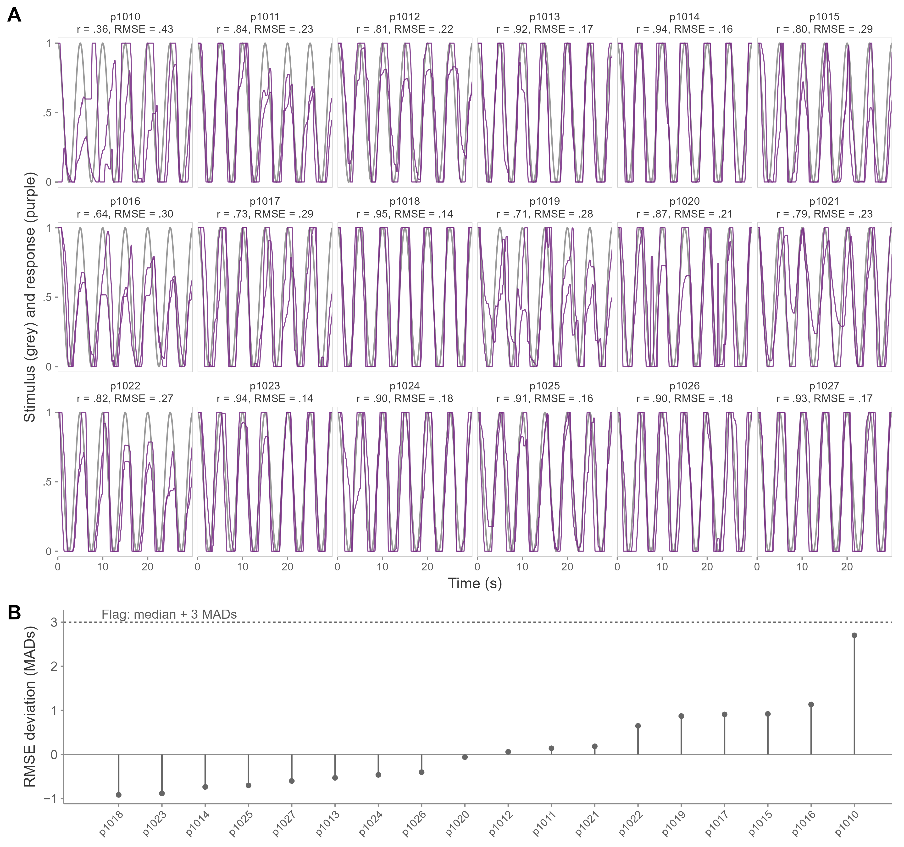
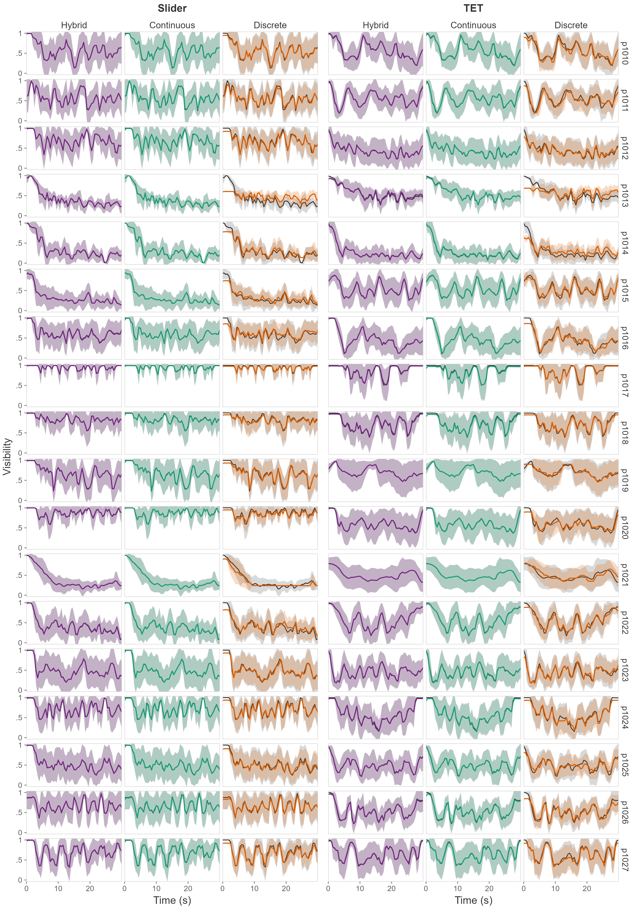
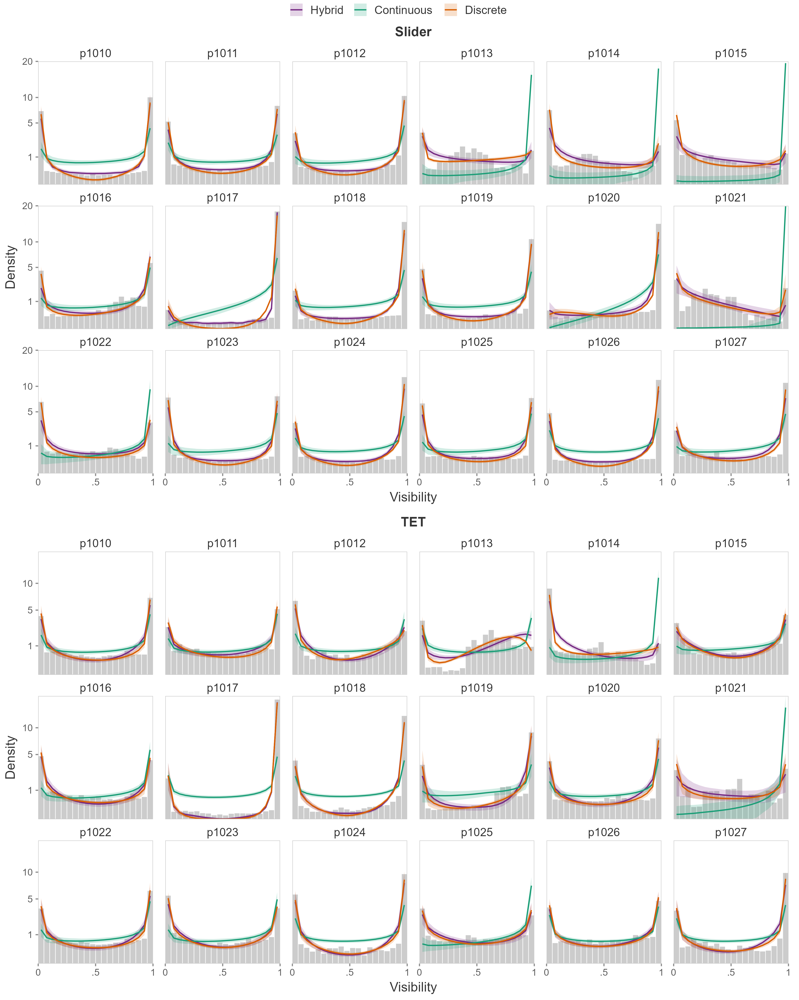

```{r}
#| label: setup-analysis-objects
#| include: false

knitr::opts_chunk$set(
  echo = FALSE,
  warning = FALSE,
  message = FALSE
)

source("scripts/functions.R")

an <- load_analysis_objects("analysis")
mc <- load_analysis_objects("model_comparison_mm") # PSIS-LOO with moment matching
mc_psis <- load_analysis_objects("model_comparison") # PSIS-LOO without moment matching

# Convergence between methods
term_txt <- function(contrast, term) {
  d <- an$h3_terms[an$h3_terms$contrast == contrast & an$h3_terms$term == term, ]
  label <- if (term == "x") "\\text{Method}" else "\\text{Method} \\times \\text{Location}"
  sprintf("$\\beta_{%s}$ = %s, %s", label, fmt(d$estimate, 3), t_txt(d$statistic, an$h3_fit$df.residual[an$h3_fit$contrast == contrast], d$p_holm, p_holm))
}

# Pareto k before and after moment matching
e <- mc_psis$fig_elpd
n_fits <- nrow(e)
n_points <- sum(e$n_obs)
n_cells <- nrow(distinct(e, participant_id, method))
n_cells_high <- nrow(distinct(filter(e, pareto_k_max > .7), participant_id, method))
n_high_fits <- function(m) sum(m$fig_elpd$pareto_k_max > .7)
n_high_points <- function(m) sum(round(m$fig_elpd$prop_k_gt_0.7 * m$fig_elpd$n_obs))
n_words <- function(n) if (n < 10) c("one", "two", "three", "four", "five", "six", "seven", "eight", "nine")[n] else big0(n)
k_left <- filter(mc$fig_elpd, pareto_k_max > .7) # Fits with responses still above .7
k_after <- if (nrow(k_left) == 0) {
  sprintf("After moment matching, no response remained above this value (maximum: %s).", fmt(max(mc$fig_elpd$pareto_k_max), 2))
} else if (nrow(distinct(k_left, participant_id, method)) == 1) {
  sprintf(
    "After moment matching, %s responses remained above this value (maximum: %s), all of them from one participant with %s.",
    n_words(n_high_points(mc)), fmt(max(k_left$pareto_k_max), 2), c(slider = "the slider", tet = "TET")[[k_left$method[1]]]
  )
} else {
  sprintf("After moment matching, %s responses remained above this value, in %s fits.", n_words(n_high_points(mc)), n_words(n_high_fits(mc)))
}
stopifnot(all(e$pareto_k_max[e$model == "discrete"] <= .7))
```

## Calibration of the Slider

The calibration phase of the slider block, described in the main text, familiarized participants with the slider. Its instructions included statements such as "While you observe the stimulus, you must move the slider up or down depending on how clearly you perceive it. If your perception does not change, you can keep the slider still for a period of time."

We planned to exclude participants who showed evidence of not understanding how to use the slider, which we assessed by visual inspection of the sinusoidal trials and by the root mean square error (RMSE) between the intensity of the stimulus and the reported visibility (@fig-s-calibration). To support the inspection, we flagged participants with a correlation between stimulus and response below .30, or with an RMSE more than three median absolute deviations above the median. `r if (sum(an$calibration_metrics$exclusion_candidate) == 0) "No participant was flagged or excluded." else "**[Flagged participants: to be checked.]**"`

```{r}
#| label: fig-s-calibration
#| fig-cap: "Sinusoidal Calibration Trials of the Slider"
#| apa-note: "Panel A: Intensity of the stimulus (grey) and normalized response (purple) in the two sinusoidal calibration trials of each participant, with the correlation and the RMSE between them. Panel B: RMSE of each participant relative to the median, in median absolute deviations (MADs)."
#| out-width: 100%
#| out-extra: 'beforenotespace="0pt"'


```

## Convergence Between Methods

@tbl-s-correlations shows the correlations between methods at each location. In the regressions, each method predicted the others in central trials, the reference level: `r term_txt("button vs slider", "x")` for button predicting slider, `r term_txt("button vs tet", "x")` for button predicting TET, and `r term_txt("slider vs tet", "x")` for slider predicting TET. The tests of whether this slope changed with the location of the target are reported in the main text.

```{r}
#| label: tbl-s-correlations
#| tbl-cap: "Correlations Between Methods at Each Location"
#| apa-note: "95% CI = 95% confidence interval. *p* values are Holm-corrected within each location. TET = Temporal Experience Tracing."

an$h3_correlations %>%
  transmute(
    location = c(near_fixation = "Central", peripheral = "Peripheral")[trial_type],
    pair = c(`button vs slider` = "Button and slider", `button vs tet` = "Button and TET", `slider vs tet` = "Slider and TET")[contrast],
    r_ci = sprintf("%s [%s, %s]", nz(r), nz(ci_low), nz(ci_high)),
    t = fmt(statistic, 2),
    p = ifelse(p_holm < .001, "< .001", nz(p_holm, 3))
  ) %>%
  knitr::kable(col.names = c("Location", "Methods", "*r* [95% CI]", t_head(an$h3_correlations$parameter), "$p_\\text{Holm}$"), align = "llccc")
```

## Implementation of the Models

In this section, we describe how the models presented in the main text were implemented. We fitted them to the slider and TET responses of each participant in peripheral trials, downsampled to 25 Hz and transformed to fall within the interval (0, 1) [@smithson2006]. The response $y_t$ at step $t$ follows a Beta distribution with mean $\mu_t$, as defined for each model in the main text, and precision $\phi$. The discrete and hybrid models are two-state hidden Markov models, with levels $a_1 < a_2$, a matrix of transition probabilities, and initial state probabilities. In the first sample of each trial, the mean is the level of the state. Priors were $\rho \sim \text{Beta}(1, 1)$, $\log\phi \sim t_3(0, 2.5)$, Dirichlet(1, 1) on the initial state probabilities and on each row of the transition matrix, $a \sim \text{Beta}(1, 1)$ in the continuous model and, in the two-state models, mildly directional priors on the levels: $\text{logit}(a_1) \sim \text{Normal}(\text{logit}(.1), 1)$ and $\text{logit}(a_2) \sim \text{Normal}(\text{logit}(.9), 1)$. Models were fitted in Stan [@carpenter2017] with four chains of 1,000 warm-up and 1,000 sampling iterations.

The times reported in the main text follow from the parameters of each participant. Because a step lasts 40 ms and the state can change at every step, a stay in a state lasts on average $0.04 / (1 - \theta)$ s, where $\theta$ is the probability of staying in that state. In addition, the distance between the expected response and the level of the state is multiplied by $\rho$ at each step, so the response covers half of this distance in $0.04 \log(.5) / \log(\rho)$ s.

## Moment Matching

PSIS-LOO was not reliable for a few responses. Pareto *k* was above 0.7 in `r n_high_fits(mc_psis)` of the `r n_fits` fits (maximum: `r fmt(max(e$pareto_k_max), 2)`), which affected `r n_high_points(mc_psis)` of the `r big0(n_points)` responses, none of them in the discrete model [@vehtari2024]. These fits belonged to `r n_cells_high` of the `r n_cells` combinations of participant and method. The differences between models need the ELPD of each response in the three models, so we fitted the three models of these combinations again, with the same settings, and applied moment matching to the responses with a Pareto *k* above 0.7 [@paananen2021]. `r k_after` The parameters and the posterior predictive checks reported in the main text come from the original fits, as moment matching only changes the ELPD.

## Posterior Predictive Checks in All the Participants

@fig-s-trajectories and @fig-s-distributions show the posterior predictive checks of the models in all the participants. @fig-s-trajectories shows the responses expected one step ahead by each model, given the previous responses, whereas @fig-s-distributions shows the distribution of the responses simulated with the parameters of each model, from the start of each trial and without using the observed responses.

```{r}
#| label: fig-s-trajectories
#| fig-cap: "Posterior Predictive Checks of the Time Course of Visibility in All the Participants"
#| apa-note: "Dark lines and grey bands show the observed mean and its 95% confidence interval across trials. Colored lines and bands show the same for the responses expected one step ahead by each model, given the previous responses."
#| out-width: 85%
#| out-extra: 'beforenotespace="0pt"'


```

```{r}
#| label: fig-s-distributions
#| fig-cap: "Posterior Predictive Checks of the Distribution of the Responses in All the Participants"
#| apa-note: "Grey bars show the observed distribution of the responses, and colored lines and bands the mean and 90% credible interval of the distribution of the responses simulated with each model, from the start of each trial and without using the observed responses. The vertical axis is on a square-root scale."
#| out-width: 95%
#| out-extra: 'beforenotespace="0pt"'


```

# References

::: {#refs}
:::
